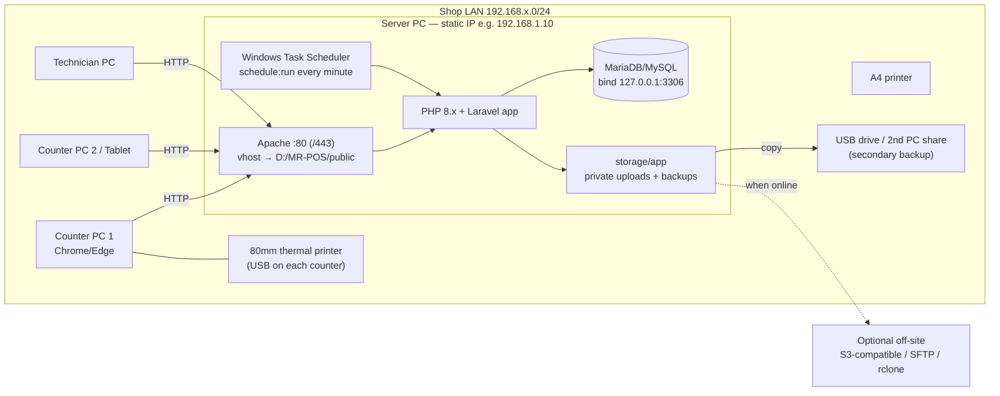
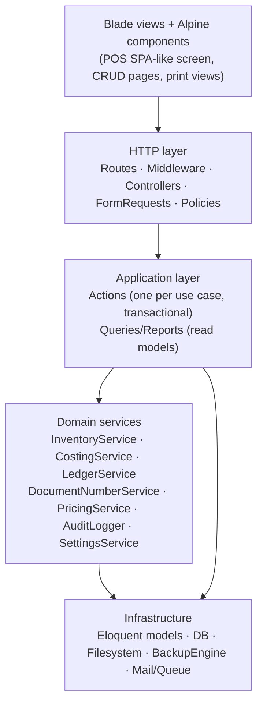
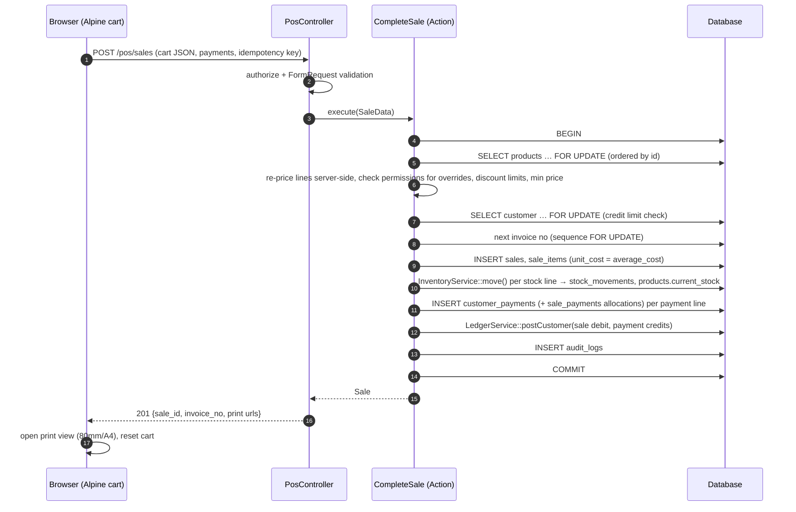

# Architecture

**System:** MR-POS for Mr Printer & Tuner · **Version:** 1.0 (Phase 1) · **Date:** 2026-10-06

---

## 1. Architectural drivers

1. **Local-first.** It must work with no internet, on one Windows PC serving the LAN.
2. **Financial correctness.** Postings are atomic, history is append-only, and there are no silent overwrites.
3. **Concurrency.** Several cashiers can sell the same stock at the same moment.
4. **Recoverability.** Backups are first-class, restore is safe, and there is an off-site copy.
5. **Maintainability.** The system is a conventional Laravel monolith that a local developer can maintain.

These drivers lead to a **modular monolith**: one Laravel application, one MariaDB/MySQL database, server-rendered pages, and a small amount of client-side JavaScript where speed matters (the POS).

---

## 2. Technology stack

| Layer | Choice | Notes |
|---|---|---|
| Language | PHP **8.3+** (8.5.10 installed) | Laravel 13 requires ^8.3 |
| Framework | **Laravel 13.x** (13.35 current) | Pin the exact minor version in `composer.lock` during Phase 2 |
| Database | **MariaDB 11.4 LTS** (11.4.13 installed in Phase 2, port 3308, localhost only) | Owner decision Q1. The old XAMPP MariaDB 10.4.32 is end-of-life; it still runs side by side for other projects (see ENVIRONMENT_CHANGES.md). InnoDB, utf8mb4_unicode_ci, session time zone +05:00 |
| Web server | Apache 2.4 (XAMPP) with a virtual host pointing to `public/` | Not `php artisan serve` (single-threaded, dev only) |
| Auth | Laravel's own authentication (session guard) with a small hand-written login controller, `RateLimiter`, and Laravel's `password.confirm` middleware | Built in Phase 2 instead of Fortify: fewer packages, full control of throttling, audit entries and the inactive-user check. Registration does not exist. 2FA can be added later |
| RBAC | **spatie/laravel-permission** | Roles and permissions tables, cached |
| UI | Blade components + **Tailwind CSS v4** + **Alpine.js** | Built with Vite into `public/build`, no CDN |
| Charts | Chart.js (npm, bundled) | |
| PDF | barryvdh/laravel-dompdf | Pure PHP, offline |
| Spreadsheet export | openspout/openspout (streaming XLSX) + native CSV | Low memory for large reports |
| Barcodes | picqer/php-barcode-generator | SVG labels; scanners act as keyboards |
| Off-site storage | league/flysystem-sftp-v3, league/flysystem-aws-s3-v3 (S3-compatible), optional rclone binary | All optional |
| Queue | `database` driver (configured, not used yet) | Off-site copies are retried by the scheduler (`pos:backup:retry-transfers`) instead of a queue worker; the queue stays available for later phases |
| Cache / session | `database` session driver, `file` cache | No Redis needed for one shop |
| Tests | **PHPUnit 12** on a dedicated MariaDB schema `mrpos_test` | Not SQLite (locking, CHECK constraints and triggers must be real). Pest was dropped to keep dependencies minimal |
| Code style | Laravel Pint (`vendor/bin/pint`) | Must pass before a phase is closed. Larastan is deferred to Phase 10 |

PHP extensions required: `pdo_mysql, mbstring, bcmath, openssl, fileinfo, gd, zip, intl, curl` (`sodium` recommended). `intl` and `sodium` were enabled in `C:/xampp/php/php.ini` in Phase 2. Run `php artisan pos:doctor`, and look at the dashboard "System checks" card, to see what the web server's PHP has loaded.

---

## 3. Deployment topology



Key points:
- The database listens on **127.0.0.1 only**. Only Apache (port 80, optionally 443) is exposed to the LAN, and the Windows Firewall rule is limited to the *Private* profile and the *LocalSubnet* scope.
- Printing happens **from the client browser** to the printer attached to that terminal. The server needs no printer drivers.
- Apache and MariaDB run as **Windows services**, so the app is available after a reboot without anyone logging in.
- Terminals reach the app by IP (`http://192.168.1.10`) or by a hostname (`http://mrpos.local`) set in each client's `hosts` file or on the router's DNS.

---

## 4. Application architecture

### 4.1 Layers



| Layer | Responsibility | Rule |
|---|---|---|
| Controllers | Parse the request, call `authorize()`, call one Action/Query, return a view, JSON or redirect | Thin: no business rules and no DB transactions |
| FormRequests | Validation of shape, types and existence | Business validation (stock, credit limit) happens in Actions |
| Policies | "Can this user do this to this record?" (ownership, assignment, status) | Every controller action is authorized |
| **Actions** | One use case = one class, e.g. `CompleteSale`, `ReceivePurchase`, `PostCustomerPayment`, `ProcessSaleReturn`, `AddPartToServiceJob`, `DeliverServiceJob`, `VoidSale`, `CreateBackup`, `RestoreBackup` | Owns the **DB transaction** and calls domain services. Throws domain exceptions. |
| Domain services | Reusable invariants: moving stock, posting ledger entries, numbering, costing, pricing | **The only code allowed** to change `current_stock`, balances and sequences |
| Queries / Reports | Read-only SQL for lists, dashboards and reports | Never write |
| Models | Relationships, casts, scopes | No posting logic in model events, except auditing of master data |

### 4.2 Single write paths (invariants)

| Data | Only writer | Guarantees |
|---|---|---|
| `products.current_stock`, `products.average_cost`, `stock_movements` | `InventoryService::move()` | Locks the product row, checks the negative-stock policy, writes the movement with before/after quantities |
| `customers.balance`, `customer_ledger_entries` | `LedgerService::postCustomer()` | Locks the customer row, appends the entry, updates the cache |
| `suppliers.balance`, `supplier_ledger_entries` | `LedgerService::postSupplier()` | As above |
| Document numbers | `DocumentNumberService::next($type)` | `SELECT … FOR UPDATE` on `document_sequences` inside the caller's transaction, so no gaps on rollback |
| `audit_logs` | `AuditLogger` | Hash chain, JSONL mirror |
| Cached totals (`paid_amount`, `due_amount`, `payment_status`, `returned_quantity`) | The Action that posts the related document | Recomputed from children, never incremented blindly |

A nightly `pos:integrity:check` recomputes every cache from its ledger and reports any drift to the admin dashboard. It does not auto-fix.

### 4.3 Module structure

```
app/
  Actions/
    Sales/          CompleteSale, VoidSale, HoldSale, ResumeHeldSale
    SaleReturns/    ProcessSaleReturn
    Purchases/      SavePurchaseDraft, ReceivePurchase, VoidPurchase
    PurchaseReturns/ProcessPurchaseReturn
    Payments/       PostCustomerPayment, VoidCustomerPayment, PostSupplierPayment, VoidSupplierPayment
    Inventory/      PostStockAdjustment, ImportProducts
    Service/        CreateServiceJob, ChangeServiceJobStatus, AddServiceJobPart, RemoveServiceJobPart,
                    DeliverServiceJob, CancelServiceJob
    Expenses/       RecordExpense, UpdateExpense, VoidExpense
    Backup/         CreateBackup, VerifyBackup, TransferBackup, RestoreBackup, ApplyRetention
  Services/         InventoryService, CostingService, LedgerService, DocumentNumberService,
                    PricingService, SettingsService, AuditLogger, Money (decimal helper)
  Enums/            SaleStatus, PaymentStatus, MovementType, ServiceJobStatus, LedgerEntryType, BackupType, …
  Exceptions/       InsufficientStockException, CreditLimitExceededException,
                    InvalidStatusTransitionException, DocumentLockedException
  Http/
    Controllers/    Pos/, Sales/, Products/, Inventory/, Purchases/, Customers/, Suppliers/,
                    Service/, Expenses/, Reports/, Admin/ (Users, Roles, Settings, Backups, AuditLogs)
    Requests/       one FormRequest per write endpoint
    Middleware/     EnsureUserIsActive, IpAllowList, ForcePasswordChange
  Models/
  Policies/
  Queries/          Dashboard/, Reports/  (read models)
  Jobs/             TransferBackupToDestination
  Console/Commands/ pos:backup:run, pos:backup:verify, pos:backup:restore, pos:backup:retry-transfers,
                    pos:integrity:check, pos:audit:verify
resources/views/
  layouts/ components/ pos/ products/ … print/ (invoice-80mm, invoice-a4, job-slip, statement, …)
resources/js/       pos.js (Alpine store for cart), charts.js
database/migrations · database/seeders (roles, permissions, settings, categories, payment methods, walk-in)
tests/Feature/<Module>/ · tests/Unit/
docs/
```

Module dependencies are one-directional. Sales, Purchases, Service and Returns depend on Inventory, Ledger, Numbering and Audit. The reverse is never true.

---

## 5. Key flows

### 5.1 Complete sale (POS-17)



- **The server re-prices everything.** The browser's prices and totals are display hints only. The server recomputes from the product price, the customer tier, and discounts the user is allowed to give.
- **Idempotency key.** The POS sends a UUID per checkout attempt, and `sales.idempotency_key` is UNIQUE. A double-click or a network retry returns the first sale instead of creating a duplicate.
- **Deadlock avoidance.** Rows are always locked in the same order: products by id, then customer, then sequence. If a deadlock still happens, the Action retries up to 3 times (`DB::transaction($fn, 3)`).

### 5.2 Receive purchase
Lock the products, allocate the invoice discount and additional cost to get landed unit costs, write a `purchase` movement for each line, recompute the average cost, post a supplier ledger credit for the grand total, post any initial payment (supplier ledger debit plus allocation), set the status to Received, and audit.

### 5.3 Service job lifecycle
See the state diagram in [DATABASE.md §7.4](DATABASE.md#74-service-job-state-machine). Parts are consumed (`AddServiceJobPart`) in their own transaction when they are added. `DeliverServiceJob` assigns the invoice number, posts the ledger debit for the job total, and takes the final payment.

### 5.4 Backup and restore
See [BACKUP_RESTORE.md](BACKUP_RESTORE.md).

---

## 6. Cross-cutting design decisions

### 6.1 Money
- DB: `DECIMAL(15,2)` for amounts, `DECIMAL(15,4)` for unit costs, `DECIMAL(12,3)` for quantities, `DECIMAL(5,2)` for rates.
- PHP: a `Money` helper based on `bcmath` strings (scale 4 internally, rounded half-up to 2 for stored amounts). Floats are never used for money.
- Discount allocation: the invoice-level discount is spread over the lines in proportion to their net value. The last line absorbs the rounding remainder so the lines sum exactly to the header. The allocated share is stored per line (`sale_items.invoice_discount_share`) so that returns refund exactly what was paid.

### 6.2 Tax
Tax is calculated per line: `tax_amount = round(taxable × rate)`. In inclusive mode, `taxable = gross / (1 + rate)`. Revenue reports always use the amount excluding tax. Purchase tax: if the shop is not claiming input tax (the default), purchase tax is **added to landed cost**. This is configurable (`purchases.tax_in_cost`).

### 6.3 Concurrency and stock
- `InventoryService::move()` runs inside the caller's transaction and requires the product row to be already locked (`lockForUpdate`).
- The negative-stock check is `current_stock + change >= 0` under the lock. This makes "two cashiers sell the last toner" safe: the second transaction waits, then fails cleanly with `InsufficientStockException`.
- There are no stock reservations for held carts, because held carts are not documents. On resume, availability is re-checked.

### 6.4 Costing: moving weighted average
| Event | Average-cost effect | Movement unit_cost |
|---|---|---|
| Purchase receipt (qty q at landed cost c) | `avg = (max(S,0)·avg + q·c) / (max(S,0) + q)` where S is the stock before | c |
| Sale / service consumption | unchanged | current avg (snapshotted on the line) |
| Sales return, restocked | `avg = (max(S,0)·avg + q·u) / (max(S,0)+q)`, u = original line unit_cost | u |
| Purchase return (q at original landed cost c) | if `S − q > 0`: `avg = (S·avg − q·c)/(S − q)`, clamped at ≥ 0; else unchanged | c |
| Adjustment in / opening | as a purchase at the entered cost (defaults to current avg) | entered cost |
| Adjustment out | unchanged | current avg |
| Voids | the exact reverse movement at the original unit cost, then recompute as above | original |

FIFO was considered and rejected for v1. Its cost layers add significant complexity, and for a shop of this size the profit difference is negligible. See DESIGN_REVIEW Q3.

### 6.5 Document numbering
`document_sequences(doc_type, prefix, next_number, padding, reset_yearly, year)` gives numbers like `INV-000123`, `JOB-000045`, `SRV-000031`, `PUR-000210`, `RCP-…`, `PAY-…`, `SRN-…`, `PRN-…`, `EXP-…`, `ADJ-…`. The number is generated inside the posting transaction, so a rollback leaves no gap. Draft purchases and held carts take no number.

### 6.6 Voids and corrections
A void never deletes anything. It writes reversing stock movements and ledger entries that reference the original document, sets `status = voided`, `voided_at`, `voided_by` and `void_reason`, and audits the change. Reports exclude voided documents. Statements show both the original entry and the reversal.

### 6.7 Settings
Settings are a typed key/value table (`settings`) behind `SettingsService`, cached in the file cache and invalidated on save. They are seeded with defaults. Every change is audited.

### 6.8 Auditing
`AuditLogger::log(event, module, subject, old, new, description)` is called explicitly from Actions for postings and voids. A model trait records `updated`/`deleted` diffs for master data (products, customers, suppliers, users, roles, settings). Password and token fields are always masked.

### 6.9 Printing
- Print views are standalone Blade pages with `@page { size: 80mm auto; margin: 0 }` or `size: A4`. The POS opens them in a hidden iframe and calls `print()`.
- For silent one-click printing on counter PCs, Chrome or Edge can be launched with `--kiosk-printing` using that terminal's default printer. This is documented in INSTALLATION.md.
- A4 is also available as a PDF via dompdf for saving or emailing.
- Cash drawer: most thermal printer drivers have an "open drawer after print" option. Direct ESC/POS printing (mike42/escpos-php over the network) is a later option (POS-25).

### 6.10 POS front-end
The POS is a single Blade page with an Alpine store holding the cart. It calls these JSON endpoints:
- `GET /pos/products/search?q=` (limit 20, indexed on sku, barcode, name)
- `GET /pos/products/barcode/{code}`
- `GET /pos/customers/search?q=`
- `POST /pos/sales`, `POST /pos/held`, `GET /pos/held`, `DELETE /pos/held/{id}`
- `POST /pos/approvals` (manager approval token, valid for 2 minutes, single use)

The rest of the application uses plain server-rendered pages and forms, with Alpine for modals, confirmations and toasts. Livewire and SPA frameworks were rejected to keep the system simple and dependency-light; DESIGN_REVIEW D-11 records that decision.

---

## 7. Background processing on Windows

Laravel's scheduler needs `php artisan schedule:run` once a minute. On Windows this is a **Task Scheduler** task with these settings: run whether the user is logged on or not, at startup, repeating every 1 minute indefinitely, as a dedicated local account.

| Schedule | Command |
|---|---|
| every minute | heartbeat file (proves the scheduler is alive; the dashboard warns if it goes quiet for 10 minutes) |
| every 15 min | `pos:backup:retry-transfers` (retries pending off-site copies when the destination is reachable) |
| configurable (default 21:00) + catch-up check every 15 min | `pos:backup:run --tier=auto` |
| optional every N hours in business hours | `pos:backup:run --tier=intraday` |
| daily 02:00 / on next start | `pos:integrity:check`, `pos:audit:verify` |
| weekly | `pos:backup:verify --deep --latest` |

**Catch-up rule.** Shop PCs are often switched off at night, so the backup command does not rely on the clock alone. Every 15 minutes it checks whether the latest successful daily backup is older than today's scheduled time. If it is, it runs immediately. This makes sure there is one daily backup per day the PC was on.

---

## 8. Security architecture

| Threat | Control |
|---|---|
| Credential guessing | `RateLimiter`: 5 failures per username+IP lock for 60 s, 30 per IP per 5 min; failures audited; optional IP allow-list |
| Session theft on LAN | HttpOnly and SameSite=Lax cookies, session regeneration on login, idle timeout, optional local HTTPS (self-signed/mkcert) with `SESSION_SECURE_COOKIE=true` |
| CSRF | Laravel CSRF middleware on all state-changing routes, including JSON POS endpoints (header token) |
| SQL injection | Eloquent/query builder bindings only. Raw SQL only with bindings, reviewed in Phase 10 |
| XSS | Blade `{{ }}` escaping. `{!! !!}` is forbidden except for vetted SVG barcodes. CSP header `default-src 'self'` (possible because there are no CDNs) |
| Broken access control | Policies on every action, a route-level `can:` middleware, scoped queries (technician jobs, own sales), tests per role |
| Mass assignment | `$fillable` on models, DTOs from FormRequests into Actions |
| File upload abuse | MIME and extension allow-list, size limits, images re-encoded with GD, random filenames, storage in `storage/app/private` (not public), served through an authorized controller with `Content-Disposition` |
| Backup theft | Backups in `storage/app/backups` (outside the web root), download needs `backups.download` + password confirmation and is audited, optional AES-256 zip encryption (mandatory for cloud destinations), DB credentials passed to mysqldump via a temporary `--defaults-extra-file`, never on the command line |
| DB exposure | MariaDB `bind-address=127.0.0.1`, an app DB user with privileges only on its own schema (no SUPER/FILE), root password set, a separate backup user |
| Tampering with history | Append-only ledgers, audit triggers, hash chain, JSONL mirror |
| Secrets | `.env` only (`APP_KEY`, DB passwords, off-site credentials). Off-site credentials are stored encrypted (`encrypted` cast). `APP_DEBUG=false` in production |
| Ransomware / disk failure | Off-machine backups (USB rotation, second PC, cloud with versioning or object lock). See BACKUP_RESTORE §8 |

---

## 9. Architecture Decision Records (summary)

| # | Decision | Alternatives rejected | Reason |
|---|---|---|---|
| ADR-01 | Modular monolith in Laravel | Microservices, desktop app | Single shop, simplest to run and back up |
| ADR-02 | Blade + Alpine + Tailwind, POS as an Alpine component | Livewire, Vue/React SPA | Fewest moving parts; Alpine is enough for the POS |
| ADR-03 | Append-only ledgers with cached balances | Balances only; computing everything on the fly | Auditable plus fast; drift detectable |
| ADR-04 | Moving weighted-average cost | FIFO, standard cost | Correct enough, simple, matches retail practice |
| ADR-05 | Payments as one `customer_payments` / `supplier_payments` row per method, with allocation tables (`sale_payments`, `service_job_payments`, `purchase_payments`) | One polymorphic payments table | Real foreign keys, one payment can settle many invoices, advances supported |
| ADR-06 | Service jobs are their own invoiced document, not a Sale | Converting a job into a POS sale | Parts are consumed before invoicing; avoids double stock deduction |
| ADR-07 | Voids instead of deletes or edits for posted documents | Editable invoices | Audit and financial integrity (BR-01) |
| ADR-08 | Database queue + Task Scheduler | Redis/Horizon, NSSM services | No extra services on Windows |
| ADR-09 | Custom backup engine (mysqldump + zip + manifest) | spatie/laravel-backup | We need restore, deep verification, tiered GFS retention, per-destination transfer state and an admin UI. Spatie covers only part of that, and wrapping it would be more complex |
| ADR-10 | Tests on MariaDB/MySQL | SQLite in-memory | Row locks, CHECK constraints and triggers must behave like production |
