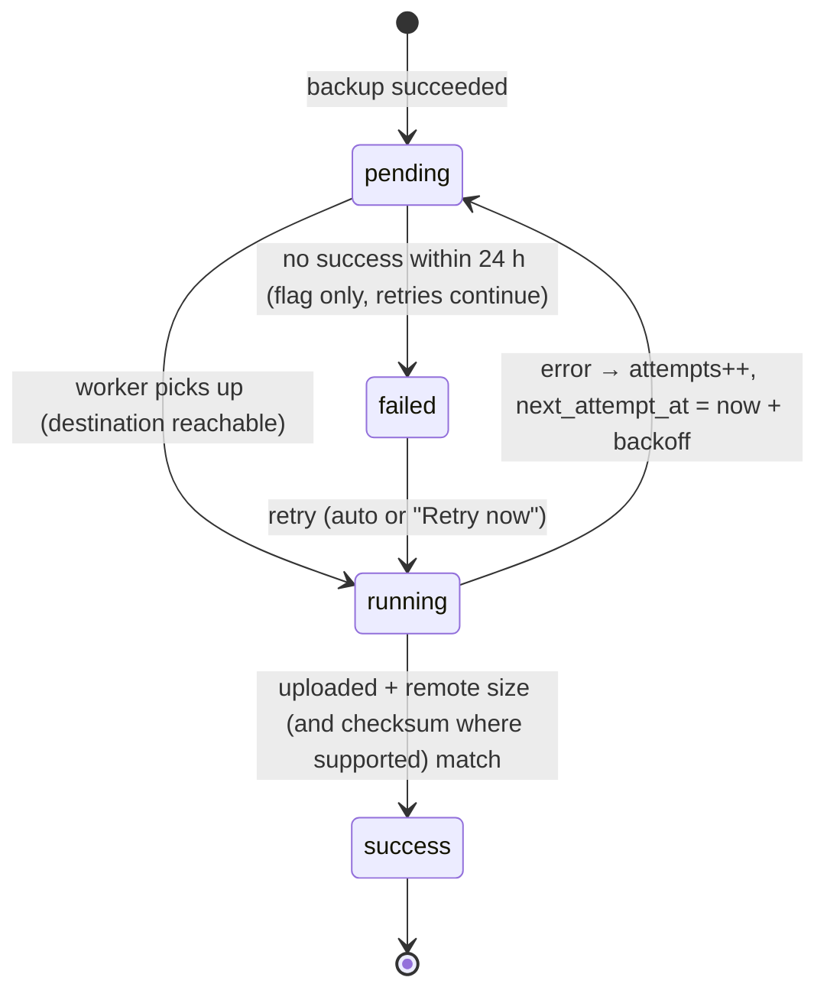

# Backup & Restore Architecture

**Status:** critical requirement · **Version:** 1.1 (Phase 2: engine, verification, retention, copies and command-line restore are built and tested; remaining items are listed in §15)

---

## 1. Goals

| Goal | Target |
|---|---|
| Recovery point (RPO) | ≤ 24 h by default. ≤ 4 h with intraday backups (recommended in busy seasons) |
| Recovery time (RTO) | ≤ 1 h onto the same PC; ≤ 2 h onto a replacement PC (including installation) |
| Survives | Accidental deletion or bad data entry, DB corruption, failed upgrade, disk failure, theft or loss of the PC, ransomware |
| Never | Interrupts selling, needs the internet to run locally, or silently replaces the only good backup |

**The 3-2-1 rule applies:** 3 copies of the data, on 2 different media, with 1 copy off-site. A backup kept only on the server's own disk protects against mistakes, not against disk failure, theft or ransomware.

---

## 2. What is backed up

Each backup is a single zip archive:

```
mrpos_2026-10-06_2100_daily.zip
├── manifest.json            app/schema version, DB server version, created_at, tier, per-table row counts,
│                            SHA-256 of every inner file, includes_files flag
├── database.sql             full logical dump
└── files/                   uploaded files (when "include files" is on, which is the default)
    ├── products/            product images
    ├── expenses/            expense receipts/attachments
    └── branding/            logo
```

Next to each zip is a `mrpos_….zip.sha256` sidecar file. Verification therefore works even if the database (which also stores the checksum) is lost.

**Dump command.** The executable path is configurable; on XAMPP it is `C:\xampp\mysql\bin\mysqldump.exe`.
```
mysqldump --defaults-extra-file=<temp file with user/password>  --single-transaction --quick
          --routines --triggers --events --hex-blob --default-character-set=utf8mb4
          --add-drop-table  mrpos
```
The dump deliberately omits `--databases`. It contains tables only, with no `CREATE DATABASE`/`USE` statements, so it can be imported into any schema name (the live DB, `mrpos_verify`, or a new PC).
- `--single-transaction` gives a consistent snapshot of InnoDB **without locking**, so the POS keeps selling during the backup.
- The DB password goes in a temporary options file (ACL'd, deleted in `finally`), never on the command line, where it would be visible in the process list.
- The process runs through Laravel's `Process` facade with a timeout. Its exit code and stderr are captured into `backups.error_message`.

**Not included:** `vendor/` and `node_modules/` (reinstallable), `.env` (secrets; see the Recovery Kit in §11), logs, and cache.

**Encryption (optional locally, mandatory for cloud).** The zip is AES-256 encrypted (`ZipArchive::EM_AES_256`) with a backup password set by the owner. The password is stored encrypted in settings, and the owner **must also keep it offline**. Without it, an off-site backup is useless after losing the PC.

---

## 3. Storage layout

```
D:\MR-POS\storage\app\backups\        (outside public/; also denied in Apache config)
├── intraday\     optional, every N hours during business hours
├── daily\
├── weekly\
├── monthly\
├── manual\       "Backup Now"
├── safety\       automatic pre-restore and pre-upgrade backups
├── uploaded\     backups uploaded for restore (e.g. from USB)
└── tmp\          work area, cleaned on every run
```

The backup root is configurable, so it can be put on a **second physical disk** if the server has one (for example `E:\MRPOS-Backups`). This is recommended.

**Tier promotion (grandfather-father-son).** Only one dump runs per scheduled cycle. After a successful daily backup:
- If today is the configured weekly day (default Sunday), or no weekly backup exists in the last 7 days, the file is **copied** to `weekly\`.
- If no monthly backup exists for the current month, the file is copied to `monthly\`.

Each copy is its own `backups` row (with a different tier) and has the same checksum.

---

## 4. Schedule

| Trigger | Tier | Default |
|---|---|---|
| Scheduled time | daily (+ weekly/monthly promotion) | 21:00 every day |
| **Catch-up** | daily | Every 15 min: if no successful daily backup exists for today and the scheduled time has passed, or for yesterday if the PC was off all evening, run it now. This handles PCs that are switched off at night |
| Intraday (optional) | intraday | Every 4 h between 10:00 and 22:00, off by default |
| Backup Now button | manual | – |
| Before restore | safety | always |
| Before an application upgrade (`pos:upgrade`) / migrations | safety | always |

Runs are serialized with a cache lock (`backup-running`), so there are never two concurrent dumps. The scheduler (Windows Task Scheduler → `schedule:run`) is described in ARCHITECTURE §7 and INSTALLATION.md.

---

## 5. Backup pipeline

```mermaid
flowchart TD
  A[Trigger: schedule / catch-up / manual / safety] --> B{Lock acquired?}
  B -- no --> Z1[Skip, log 'already running']
  B -- yes --> C[Insert backups row status=running]
  C --> D[Check free disk space ≥ 3× last backup size]
  D -- low --> F[status=failed, alert]
  D -- ok --> E[mysqldump → tmp/database.sql]
  E -- exit≠0 --> F
  E --> G[Copy uploaded files → tmp/files]
  G --> H[Write manifest.json with row counts + inner checksums]
  H --> I[Zip (+AES-256 if enabled) → tier folder]
  I --> J[SHA-256 → DB + .sha256 sidecar]
  J --> K[Quick verify: reopen zip, check manifest + inner checksums]
  K -- fail --> F
  K -- pass --> L[status=success, verify_status=passed(quick)]
  L --> M[GFS promotion: weekly/monthly copies]
  M --> N[Queue transfer to each active destination: backup_transfers status=pending]
  N --> O[Apply local retention]
  O --> P[Audit log entry + release lock]
  F --> P
```

---

## 6. Verification

| Level | When | Checks |
|---|---|---|
| **Quick** | After every backup; on demand | The file exists and its size matches; the SHA-256 matches the DB and the sidecar; the zip opens (and decrypts); the manifest parses; every inner file's SHA-256 matches; `database.sql` starts with the dump header and ends with the "Dump completed" footer |
| **Deep** | Weekly (latest daily), before every restore, on demand | Quick checks, then import `database.sql` into a scratch schema `mrpos_verify`. Every table in the manifest exists; row counts equal the manifest's; the `migrations` table is present; a sample integrity query runs (sum of stock movements = current stock for 50 random products). Then `DROP DATABASE mrpos_verify` |

Deep verification needs a DB user with `CREATE`/`DROP` on `mrpos_verify` only (see INSTALLATION.md). Results are stored in `verify_status`, `verify_level`, `verified_at` and `verify_notes`. A failure raises an admin warning.

---

## 7. Retention

Retention runs after each successful backup and only touches **successful** backups. Failed runs leave no file; their rows stay as history.

| Tier | Keep (default, configurable) |
|---|---|
| intraday | last 12 (about 2 days) |
| daily | last **7** |
| weekly | last **4** |
| monthly | last **6** |
| manual | last 20 (or "keep all") |
| safety | last 5 **and** at least 30 days |
| uploaded | deleted after a successful restore, or after 7 days |

Safeguards:
- `is_protected` backups (the admin can "pin" one, e.g. "before year-end") are never pruned.
- The **newest backup that passed deep verification** is never pruned, even if it is outside the window.
- Retention never runs if the current backup failed. A broken backup job must not delete the last good ones.
- A pruned backup keeps its `backups` row with `pruned_at` set, so the history remains complete.
- Remote retention is **off by default**. The app never deletes remote copies unless the admin enables it per destination. This protects against a compromised server erasing the off-site copies; use provider-side lifecycle rules instead.

---

## 8. Off-site / secondary copies

### 8.1 Destinations (configurable, any number)

| Driver | Use | Needs internet |
|---|---|---|
| `local_path` | A USB drive (`F:\MRPOS-Backups`) or a share on another shop PC (`\\COUNTER2\MRPOS-Backups`) | No. **The minimum recommended setup** |
| `sftp` | The owner's home PC or a VPS | Yes |
| `s3` | Any S3-compatible store: Backblaze B2, Wasabi, Cloudflare R2, AWS S3 | Yes |
| `rclone` | Google Drive / OneDrive / Dropbox through an installed `rclone.exe` remote | Yes |

Cloud drivers (`sftp`, `s3`, `rclone`) **refuse to activate unless backup encryption is on.**

### 8.2 Transfer state machine



- Backoff: 5 min, 15 min, 1 h, 3 h, then every 6 h. Retries continue until success, or until the local file is pruned (then the transfer is marked `failed` permanently and alerted).
- Reachability is pre-checked cheaply (path exists / TCP connect / HEAD request) before a large upload is attempted. **No internet means the transfer stays pending and nothing else is affected**, so local backups and the POS continue normally.
- Transfers run on the database queue, processed by the per-minute scheduler, and never inside a web request.
- Each destination shows its last success, its last error, and the count of pending transfers.

### 8.3 Ransomware and theft guidance (documented for the owner)
- Rotate **two USB drives**: one plugged in, one at home, swapped weekly. A drive that is unplugged cannot be encrypted by ransomware.
- For cloud: use a bucket with **versioning or object lock** and app credentials **without delete permission**.
- Enable encryption, and store the backup password and the Recovery Kit (§11) away from the shop.

---

## 9. Monitoring & admin warnings

These are shown as a persistent banner on the admin dashboard and on the Backups page, and as a daily item in the audit log:

| Condition | Default threshold | Severity |
|---|---|---|
| No successful backup within the period | 26 h | 🔴 critical |
| Last backup failed | latest run failed | 🔴 |
| Verification failed (quick or deep) | any | 🔴 |
| No deep verification within | 8 days | 🟠 |
| Off-site transfer pending or failed for longer than | 48 h | 🟠 |
| Destination unreachable / misconfigured | last check failed | 🟠 |
| Backup disk free space low | < 10% or < 2 GB | 🟠 |
| Encryption enabled but password not confirmed as "stored offline" | – | 🟡 |
| Scheduler not running (no heartbeat in 10 min) | heartbeat file | 🔴 (backups would silently stop) |

The **scheduler heartbeat** is important. A scheduled task that silently stops is the most common way backups fail. Every `schedule:run` touches a heartbeat, and the web app checks its age.

---

## 10. Backup settings (admin UI)

- Daily time; weekly day; intraday on/off, interval and hours.
- Retention counts per tier.
- Include uploaded files (on/off).
- Backup root folder (validated as writable, with a disk-space display).
- Encryption on/off, plus the password (entered twice, never displayed again).
- Destinations: add, edit, test connection, enable/disable, remote retention toggle.
- Alert thresholds.
- `mysqldump`/`mysql` executable paths (auto-detected for XAMPP and Laragon).

All changes need `backups.settings` and a password confirmation, and are audited.

---

## 11. Recovery Kit (printed or stored off-site by the owner)

The install command generates a one-page "Recovery Kit" containing:
1. `APP_KEY`. It is needed to decrypt stored destination credentials and encrypted settings after moving to a new PC.
2. The backup encryption password. It is written by hand by the owner and never printed by the system.
3. The DB name and users (not passwords, which are re-creatable).
4. The locations of off-site copies and how to download them.
5. A pointer to this document and to INSTALLATION.md.

---

## 12. Restore procedure

### 12.1 Preconditions and safeguards
- Only users with `backups.restore` (Admin by default).
- Password re-confirmation, **plus** typing the confirmation phrase `RESTORE <backup date>`.
- The backup must pass **deep verification** immediately before the restore.
- **Schema compatibility:** the backup's migrations must be a subset of the app's migrations. An older backup is fine, and newer migrations run after the restore. A backup **from a newer app version** is refused, with the message "upgrade the application first".
- A clear warning screen showing: the backup date and time, how much data will be lost (records created after the backup, from row-count comparisons), that all terminals will be logged out, and that open POS carts not yet held will be lost.

### 12.2 Restore flow

```mermaid
flowchart TD
  S[Admin selects backup or uploads zip] --> V[Deep verify + compatibility check]
  V -- fail --> X[Abort: show reason, audit 'restore_rejected']
  V -- pass --> W[Warning screen + password confirm + typed phrase]
  W --> M[Maintenance mode: artisan down --secret, other terminals see 'Restore in progress']
  M --> SB[Safety backup of current DB + files, tier=safety, protected 30 days]
  SB -- fail --> U1[Abort, app up, nothing changed]
  SB -- ok --> I[Import database.sql into the live schema]
  I -- fail --> R[Auto-rollback: import the safety backup] --> U2[App up, status=rolled_back, alert]
  I -- ok --> FL[Restore files: extract to tmp, swap directories, keep the old ones as *.pre-restore]
  FL --> MG[php artisan migrate --force  (bring the older schema up to date)]
  MG --> C[Clear caches, truncate sessions → everyone re-logs in]
  C --> L[Insert backup_restores row + audit entry 'restore_performed' into the RESTORED DB, and append to storage/logs/restore.log]
  L --> UP[artisan up]
```

Implementation notes:
- The restore runs as a **background CLI process** (`pos:backup:restore --id=…`) started by the web UI, and the UI polls its progress. Apache request timeouts therefore cannot cut a restore in half.
- The same command can be run directly from a terminal (`php artisan pos:backup:restore path\to\file.zip`) for disaster recovery when the web UI cannot start, for example on a fresh PC.
- **The audit-log gap:** restoring an older backup removes the audit entries made after it. Three mechanisms mitigate this:
  1. The safety backup preserves them.
  2. The JSONL audit mirror in `storage/logs/audit/` is **not** part of the restore, so it keeps the full history.
  3. The restore record itself is written into the restored database.

### 12.3 Restore onto a new PC (disaster recovery)
1. Install the stack and the app following INSTALLATION.md, with the same app version or newer.
2. Put the original `APP_KEY` from the Recovery Kit in `.env`.
3. Copy the backup zip from the USB drive or download it from the cloud.
4. Run `php artisan pos:backup:restore F:\MRPOS-Backups\mrpos_….zip`. It asks for the encryption password, verifies, restores and migrates.
5. Log in, check the dashboard totals against the last printed daily closing, and re-enter any sales made after the backup from the paper receipts.

---

## 13. Security of backups

| Control | Detail |
|---|---|
| Location | `storage/app/backups`, outside `public/`; Apache `Require all denied` on `storage` as defense in depth |
| Access | Download needs `backups.download` + password confirmation and is streamed through a controller (no direct URLs). Every download is audited with IP |
| Upload for restore | Admin only; `.zip` only; size limit 2 GB; manifest validated **before** any extraction; zip-slip protection (reject `..` and absolute paths); extracted only into `tmp\` |
| Encryption | AES-256, mandatory for cloud destinations |
| Credentials | Destination secrets are stored with the `encrypted` cast (APP_KEY). The dump uses a temporary options file. The backup DB user has least privilege |
| File system | The `D:\MR-POS\storage\app\backups` NTFS ACL allows only the Apache service account and Administrators |

---

## 14. Tests (Phase 9 exit criteria)
- Backup creates a zip, manifest, sidecar and history row; the checksum matches; files are included.
- A corrupted zip (one flipped byte) fails quick verification. A truncated `database.sql` fails deep verification.
- Retention keeps exactly N per tier and never deletes a protected or newest-verified backup, or anything after a failed run.
- The catch-up logic runs when the scheduled time was missed and does not run twice in a day.
- A transfer to an unreachable destination stays `pending` and becomes `success` after the destination comes back (fake disk).
- Restore: a safety backup is created first; data matches the backup; newer migrations are applied; a forced import failure triggers the rollback to the safety backup; restoring from a newer schema is refused; a non-admin gets 403; restore without password confirmation is refused.

---

## 15. Implementation status (end of Phase 2)

The owner asked for backups and a *tested* restore to exist from the start, so the core of this design was built in Phase 2 rather than Phase 9.

### Built and tested

| Capability | Where |
|---|---|
| Backup archive: `manifest.json` + `database.sql` + uploaded files, SHA-256 checksum file, optional AES-256 encryption | `BackupService`, `DatabaseDumper` |
| Consistent dump without blocking sales (`--single-transaction`), credentials never on a command line, `DEFINER` stripped so any account can restore | `DatabaseDumper`, `ToolLocator` |
| Tiers daily / weekly / monthly / manual / safety, with weekly and monthly copies promoted from the daily backup | `BackupService::promote` |
| Retention (defaults 7 / 4 / 6 / 20 manual / 5 safety, safety kept at least 30 days; protected, newest and newest-deep-verified backups never pruned; nothing pruned after a failed run) | `RetentionService` |
| Quick verification after every backup; deep verification (imports into the scratch schema `mrpos_verify` and compares tables and row counts) | `BackupVerifier` |
| Schedule with catch-up after the PC was off, plus an automatic weekly restore test | `BackupSchedule`, `routes/console.php` |
| Second copies to a USB drive / other PC with pending state, retry with backoff, verification of the copy, and a "requires encryption" refusal | `TransferService` (driver `local_path`) |
| Health warnings on the dashboard, the sidebar dot and the Backups page (no backup, too old, last attempt failed, failed verification, no second copy, unreachable destination, stuck copies, low disk, scheduler stopped) | `BackupHealth` |
| Backups page: Backup Now, history, test restore, download (password re-entry), delete / protect, destinations, schedule / retention / encryption settings | `Admin\BackupController` |
| Safe restore from the command line: deep verify, version-compatibility check, safety backup first, maintenance mode, wipe + import, files restored (old ones moved aside), `migrate`, sessions and cache cleared, automatic rollback if the import fails | `RestoreService`, `pos:backup:restore` |
| Restore needs an Admin login at the terminal plus a typed confirmation phrase. On a brand-new empty database (replacement PC) the login is skipped because no users exist yet | `BackupRestoreCommand` |
| Every action audited; failures recorded in `backups.error_message`, the audit log and the application log, and shown on screen | all of the above |

### Deliberately deferred

| Item | Planned |
|---|---|
| Restore from the web page (today: command line only, by design, because a restore replaces all data and logs everybody out) | Phase 9 |
| Cloud destinations: SFTP, S3-compatible, rclone. The `backup_destinations` / `backup_transfers` tables and the retry engine are ready; only the drivers are missing, and cloud drivers will refuse to run unencrypted | Phase 9 |
| Intraday backups; uploading a backup from USB through the page; the printable Recovery Kit | Phase 9 |

### Commands

```
php artisan pos:backup:run --tier=manual         # make a backup now (also: daily, weekly, monthly)
php artisan pos:backup:run --tier=auto           # what the scheduler runs every 15 minutes
php artisan pos:backup:list                      # history and verification status
php artisan pos:backup:verify --latest --deep    # prove the newest backup restores
php artisan pos:backup:verify --file=F:\x.zip    # check a backup file from anywhere
php artisan pos:backup:retry-transfers           # push pending copies to the USB drive / second PC
php artisan pos:backup:restore --id=7            # restore (asks for an admin login + confirmation)
php artisan pos:backup:restore F:\x.zip          # restore from a file, e.g. on a replacement PC
php artisan pos:audit:verify                     # check the audit log for tampering
```

### Results of the Phase 2 drills (real database, real tools)

| Drill | Result |
|---|---|
| Backup with the read-only `mrpos_backup` account and the MariaDB 11.4 tools | Passed |
| Deep verification: 21 tables imported into the scratch schema, row counts matched | Passed |
| Backup Now from the web page, and a password-protected download that is a valid zip | Passed |
| Restore drill: a marker user deleted and a file changed after the backup, then restored with maintenance mode on | The marker user and the file came back in 3.6 s; the audit chain stayed intact; the web app came back up |
| Restore command with a wrong password, or as a non-admin | Refused, nothing changed |
| A failure found by the drill: under PHP's built-in server the dump failed with Windows error 10106 because the child process had no `SystemRoot` | Fixed (it is always passed explicitly now) and covered by a regression test that reproduces the error without the fix |
