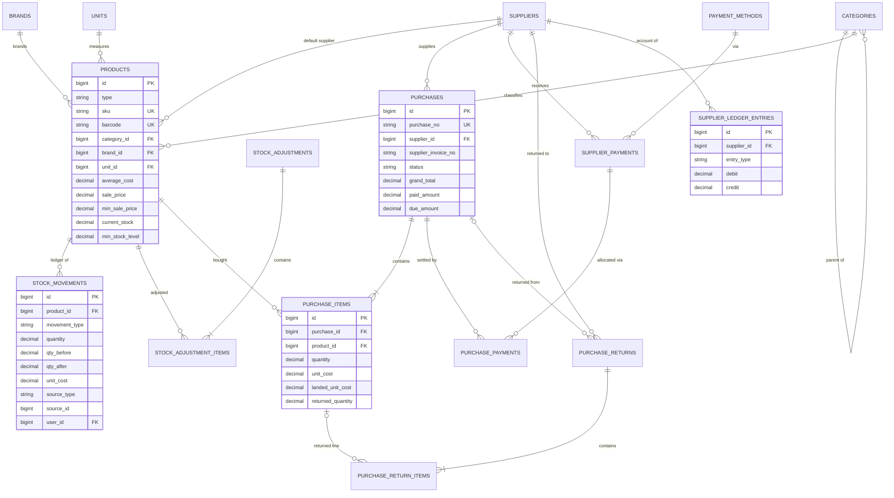
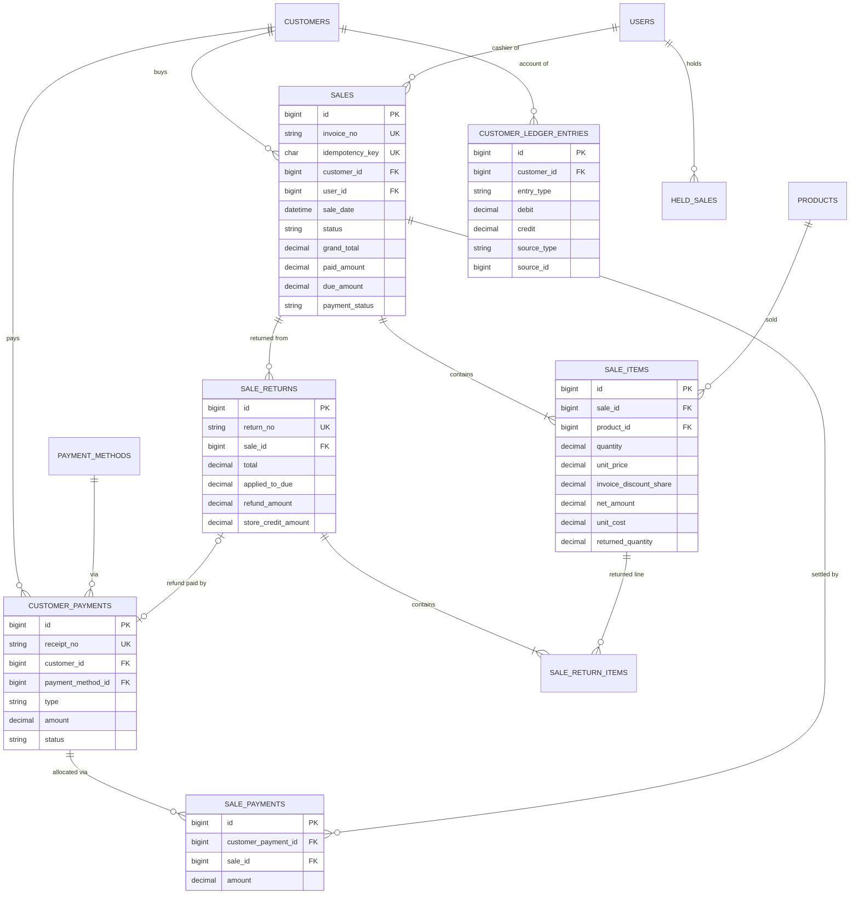
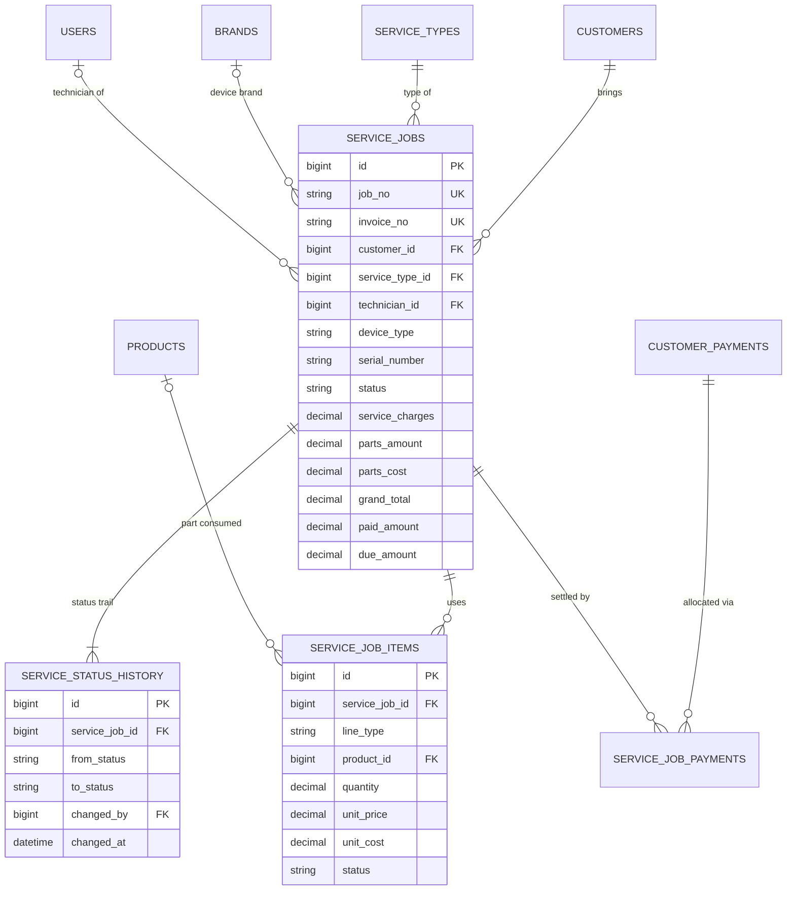
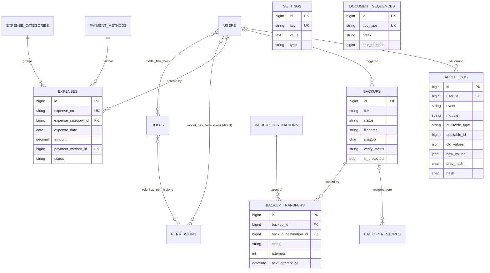
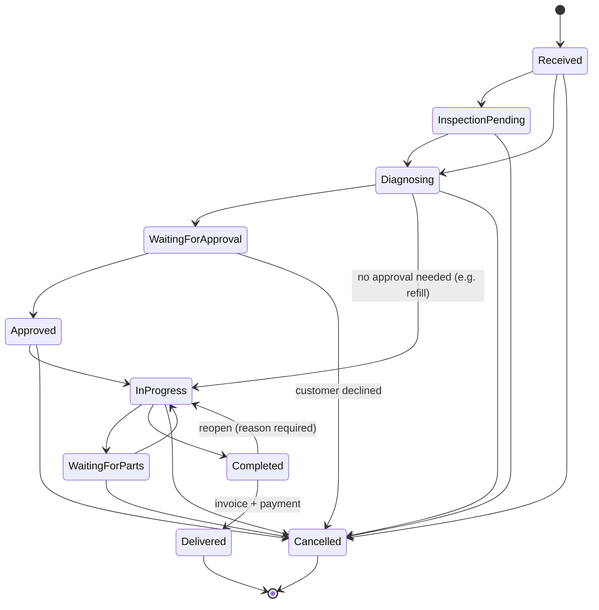

# Database Design

**Engine:** MariaDB 10.11+/11.4 LTS or MySQL 8.0+ · InnoDB · `utf8mb4_unicode_ci` · **Version:** 1.0 (Phase 1)

---

## 1. Conventions

| Item | Convention |
|---|---|
| Primary keys | `id BIGINT UNSIGNED AUTO_INCREMENT` |
| Foreign keys | `<table_singular>_id`, always declared with a constraint. `ON DELETE RESTRICT` for anything financial; `ON DELETE CASCADE` only for pure child lines of an unposted parent (held carts) |
| Money | `DECIMAL(15,2)` (up to Rs. 9,999,999,999,999.99) |
| Unit cost | `DECIMAL(15,4)` (average cost precision) |
| Quantity | `DECIMAL(12,3)`, so toner powder in grams and ink in ml are supported |
| Rates | `DECIMAL(5,2)` percent |
| Status/type | `VARCHAR(30)` backed by PHP enums. Not DB ENUM, so adding a value does not need an ALTER on big tables. Valid values are listed below and enforced by CHECK constraints on key tables |
| Timestamps | `created_at`, `updated_at` (TIMESTAMP, app timezone Asia/Karachi). Business dates are separate columns (`sale_date`, `purchase_date`, …) |
| Soft deletes | `deleted_at` **only** on master data (products, customers, suppliers, categories, brands, units). Never on financial documents |
| Actor columns | `created_by`, `updated_by` → `users.id` (nullable for system/scheduler) |
| Snapshots | Lines store names, prices, costs and rates as of posting time, so later master-data edits never change history |
| Polymorphic refs | Used **only** for ledger/movement/audit back-references (`source_type`, `source_id`), never for core relationships. A morph map in `AppServiceProvider` keeps stored type names short and stable (`sale`, `purchase`, …) |

---

## 2. Entity catalogue

40 domain tables, plus the Laravel framework tables (`sessions`, `cache`, `cache_locks`, `jobs`, `job_batches`, `failed_jobs`, `password_reset_tokens`, `migrations`) and the spatie permission tables.

### 2.1 Identity, access & configuration

**users**
| Column | Type | Notes |
|---|---|---|
| id | PK | |
| name | varchar(100) | |
| username | varchar(50) UNIQUE | login |
| email | varchar(150) UNIQUE NULL | |
| phone | varchar(30) NULL | |
| password | varchar(255) | bcrypt/argon2id hash |
| is_active | bool default 1 | |
| must_change_password | bool default 0 | |
| last_login_at, last_login_ip | timestamp NULL, varchar(45) NULL | |
| remember_token | varchar(100) NULL | |
| timestamps | | Users are never deleted, only deactivated (they are referenced everywhere) |

**roles, permissions, model_has_roles, model_has_permissions, role_has_permissions**: the standard spatie/laravel-permission schema (`guard_name = web`). The permission catalogue is in [RBAC.md](RBAC.md).

**settings**
| Column | Type | Notes |
|---|---|---|
| id | PK | |
| group | varchar(50) | shop, sales, tax, inventory, receipt, backup, security |
| key | varchar(100) UNIQUE | e.g. `sales.max_discount_percent` |
| value | text NULL | |
| type | varchar(20) | string, int, decimal, bool, json, encrypted |
| updated_by | FK users NULL | |
| timestamps | | |

**payment_methods**
| id | name varchar(50) UNIQUE | code varchar(30) UNIQUE | kind (`cash`,`bank`,`card`,`wallet`,`customer_credit`,`other`) | requires_reference bool | is_active bool | is_system bool (cash and customer_credit cannot be removed) | sort_order int | timestamps |
|---|---|---|---|---|---|---|---|---|

Seeded with: Cash, Bank Transfer, Card, Easypaisa, JazzCash, Cheque, Customer Credit.

**document_sequences**
| id | doc_type varchar(30) UNIQUE | label varchar(60) | prefix varchar(20) | next_number BIGINT UNSIGNED | padding tinyint | reset_yearly bool | current_year smallint NULL | timestamps |
|---|---|---|---|---|---|---|---|

### 2.2 Catalogue

**categories**: id, parent_id FK categories NULL (max depth 2, enforced in the app), name varchar(100), slug, is_active, sort_order, timestamps, deleted_at. UNIQUE(parent_id, name).

**brands**: id, name varchar(100) UNIQUE, is_active, timestamps, deleted_at.

**units**: id, name varchar(30), short_name varchar(10) UNIQUE, allows_decimal bool, timestamps.

**products**
| Column | Type | Notes |
|---|---|---|
| id | PK | |
| type | varchar(20) | `stock` / `service`, CHECK |
| name | varchar(200) | FULLTEXT(name, model) index for search |
| sku | varchar(50) UNIQUE | |
| barcode | varchar(64) UNIQUE NULL | |
| category_id | FK categories | leaf or parent |
| brand_id | FK brands NULL | |
| unit_id | FK units | |
| model | varchar(100) NULL | indexed |
| description | text NULL | |
| last_purchase_cost | DECIMAL(15,4) default 0 | |
| average_cost | DECIMAL(15,4) default 0 | system-maintained |
| sale_price | DECIMAL(15,2) | CHECK ≥ 0 |
| wholesale_price | DECIMAL(15,2) NULL | |
| min_sale_price | DECIMAL(15,2) NULL | CHECK ≤ sale_price (app) |
| tax_rate | DECIMAL(5,2) NULL | NULL = default rate |
| current_stock | DECIMAL(12,3) default 0 | cache of stock_movements; always 0 for `service` |
| min_stock_level | DECIMAL(12,3) NULL | NULL = global threshold |
| rack_location | varchar(50) NULL | |
| default_supplier_id | FK suppliers NULL | |
| warranty_months | smallint NULL | |
| warranty_terms | varchar(255) NULL | |
| image_path | varchar(255) NULL | private disk path |
| is_active | bool | |
| created_by, updated_by | FK users NULL | |
| timestamps, deleted_at | | |

Indexes: (is_active, category_id), (brand_id), (model), plus the unique and fulltext indexes above.

### 2.3 Inventory

**stock_movements** (append-only)
| Column | Type | Notes |
|---|---|---|
| id | PK | |
| product_id | FK products | |
| movement_type | varchar(30) | opening, purchase, purchase_return, purchase_void, sale, sale_return, sale_void, service_consumption, service_return, adjustment_in, adjustment_out (CHECK) |
| quantity | DECIMAL(12,3) | signed: + in, − out; CHECK ≠ 0 |
| qty_before | DECIMAL(12,3) | |
| qty_after | DECIMAL(12,3) | CHECK qty_after = qty_before + quantity |
| unit_cost | DECIMAL(15,4) | |
| avg_cost_after | DECIMAL(15,4) | for audit of the costing |
| source_type, source_id | varchar(30), BIGINT | morph to sale, purchase, sale_return, purchase_return, service_job, stock_adjustment |
| source_line_id | BIGINT NULL | the specific line |
| notes | varchar(255) NULL | |
| user_id | FK users NULL | |
| created_at | timestamp | (no updated_at) |

Indexes: (product_id, id), (source_type, source_id), (movement_type, created_at), (created_at).

**stock_adjustments**: id, adjustment_no UNIQUE, adjustment_date, reason (count_correction, damage, loss, found, expiry, opening, other), notes, status (`posted`,`voided`), voided_at/by/reason, created_by, timestamps.
**stock_adjustment_items**: id, stock_adjustment_id FK, product_id FK, quantity DECIMAL(12,3) signed (≠ 0), unit_cost DECIMAL(15,4), notes.

### 2.4 Parties & ledgers

**customers**
| Column | Type | Notes |
|---|---|---|
| id | PK | |
| code | varchar(20) UNIQUE | auto |
| name | varchar(150) | indexed |
| company | varchar(150) NULL | |
| phone | varchar(30) NULL | indexed (not unique: families or companies share numbers) |
| whatsapp | varchar(30) NULL | |
| email | varchar(150) NULL | |
| address | text NULL | |
| price_tier | varchar(20) default `retail` | retail / wholesale |
| allow_credit | bool default 0 | |
| credit_limit | DECIMAL(15,2) NULL | NULL = unlimited when allow_credit |
| opening_balance | DECIMAL(15,2) default 0 | informational; posted as a ledger entry |
| balance | DECIMAL(15,2) default 0 | cache; + = customer owes the shop, − = shop owes the customer (store credit) |
| is_walk_in | bool default 0 | exactly one row; a generated column + UNIQUE enforces at most one |
| is_active | bool | |
| notes | text NULL | |
| created_by, updated_by, timestamps, deleted_at | | |

**suppliers**: id, code UNIQUE, name, company, contact_person, phone, whatsapp, email, address, ntn, opening_balance, balance (cache; + = the shop owes the supplier), is_active, notes, created_by, updated_by, timestamps, deleted_at.

**customer_ledger_entries** (append-only)
| Column | Type | Notes |
|---|---|---|
| id | PK | |
| customer_id | FK customers | |
| entry_date | date | business date |
| entry_type | varchar(30) | opening_balance, sale, sale_void, service_invoice, service_void, payment, payment_void, refund, refund_void, sale_return, balance_adjustment |
| debit | DECIMAL(15,2) default 0 | increases what the customer owes |
| credit | DECIMAL(15,2) default 0 | decreases what the customer owes |
| source_type, source_id | morph | |
| description | varchar(255) | |
| created_by | FK users NULL | |
| created_at | timestamp | |

CHECK `debit >= 0 AND credit >= 0 AND (debit > 0) <> (credit > 0)` (exactly one side). Index (customer_id, entry_date, id).

**supplier_ledger_entries**: the same shape. Types: opening_balance, purchase, purchase_void, payment, payment_void, purchase_return, refund_received, balance_adjustment. **credit** increases the payable, **debit** decreases it.

### 2.5 Purchasing

**purchases**
| Column | Type | Notes |
|---|---|---|
| id | PK | |
| purchase_no | varchar(30) UNIQUE NULL | assigned when received (drafts have none) |
| supplier_id | FK suppliers | |
| supplier_invoice_no | varchar(50) NULL | UNIQUE(supplier_id, supplier_invoice_no) |
| purchase_date | date | |
| status | varchar(20) | draft, received, voided (CHECK) |
| subtotal | DECIMAL(15,2) | Σ line qty×cost − line discounts |
| discount_amount | DECIMAL(15,2) | invoice-level |
| tax_amount | DECIMAL(15,2) | |
| additional_cost | DECIMAL(15,2) | freight etc. |
| grand_total | DECIMAL(15,2) | |
| paid_amount | DECIMAL(15,2) | cache = Σ purchase_payments of non-voided payments |
| returned_amount | DECIMAL(15,2) | cache |
| due_amount | DECIMAL(15,2) | cache = grand_total − returned_amount − paid_amount (≥ 0 as displayed) |
| payment_status | varchar(20) | unpaid, partial, paid |
| notes | text NULL | |
| received_at, received_by | | |
| voided_at, voided_by, void_reason | | |
| created_by, updated_by, timestamps | | |

**purchase_items**: id, purchase_id FK, product_id FK, quantity (> 0), unit_cost DECIMAL(15,4), discount_amount, tax_amount, line_total DECIMAL(15,2), landed_unit_cost DECIMAL(15,4) (set on receive), returned_quantity DECIMAL(12,3) default 0 (cache, CHECK ≤ quantity).

**supplier_payments**: id, payment_no UNIQUE, supplier_id FK, payment_date, payment_method_id FK, type (`payment` = shop pays the supplier, `refund` = supplier refunds the shop), amount DECIMAL(15,2) (> 0), reference_no, notes, status (posted, voided), voided_at/by/reason, created_by, timestamps.

**purchase_payments** (allocation): id, supplier_payment_id FK, purchase_id FK, amount (> 0). UNIQUE(supplier_payment_id, purchase_id). Rule: Σ allocations ≤ payment amount. The unallocated rest is a supplier advance.

**purchase_returns**: id, return_no UNIQUE, supplier_id FK, purchase_id FK NULL, return_date, subtotal, tax_amount, total, settlement (`adjust_balance`, `refund`), supplier_payment_id FK NULL (refund receipt), reason, status (posted, voided), voided_*, created_by, timestamps.
**purchase_return_items**: id, purchase_return_id FK, purchase_item_id FK NULL, product_id FK, quantity, unit_cost DECIMAL(15,4), line_total.

### 2.6 Sales

**sales**
| Column | Type | Notes |
|---|---|---|
| id | PK | |
| invoice_no | varchar(30) UNIQUE | |
| idempotency_key | char(36) UNIQUE | from the POS client |
| customer_id | FK customers | walk-in if none |
| user_id | FK users | cashier |
| approved_by | FK users NULL | manager approval, if any |
| sale_date | datetime | |
| price_tier | varchar(20) | snapshot |
| status | varchar(20) | completed, voided (CHECK) |
| items_total | DECIMAL(15,2) | Σ qty × unit_price |
| line_discount_total | DECIMAL(15,2) | |
| invoice_discount_amount | DECIMAL(15,2) | |
| invoice_discount_percent | DECIMAL(5,2) NULL | if entered as % |
| tax_total | DECIMAL(15,2) | |
| round_off | DECIMAL(15,2) | may be negative |
| grand_total | DECIMAL(15,2) | |
| paid_amount | DECIMAL(15,2) | cache: Σ sale_payments of non-voided receipts − refunds against this sale |
| returned_amount | DECIMAL(15,2) | cache |
| due_amount | DECIMAL(15,2) | cache |
| payment_status | varchar(20) | paid, partial, unpaid |
| amount_tendered, change_amount | DECIMAL(15,2) | cash handling, for the receipt |
| notes | text NULL | |
| print_notes | bool | |
| voided_at, voided_by, void_reason | | |
| client_ip | varchar(45) | terminal |
| timestamps | | |

Indexes: (sale_date), (customer_id, sale_date), (user_id, sale_date), (status, payment_status).

**sale_items**
| Column | Type | Notes |
|---|---|---|
| id | PK | |
| sale_id | FK sales | |
| product_id | FK products | |
| product_name, sku | snapshots | |
| quantity | DECIMAL(12,3) > 0 | |
| list_price | DECIMAL(15,2) | price before any override (to report overrides) |
| unit_price | DECIMAL(15,2) | charged price |
| discount_amount | DECIMAL(15,2) | line discount |
| invoice_discount_share | DECIMAL(15,2) | allocated header discount |
| tax_rate | DECIMAL(5,2) | |
| tax_amount | DECIMAL(15,2) | |
| net_amount | DECIMAL(15,2) | excl. tax, after both discounts (= revenue) |
| line_total | DECIMAL(15,2) | net_amount + tax |
| unit_cost | DECIMAL(15,4) | average cost at sale (0 for service products) |
| serial_number | varchar(100) NULL | |
| warranty_until | date NULL | |
| returned_quantity | DECIMAL(12,3) default 0 | cache, CHECK ≤ quantity |

Index (product_id, sale_id).

**held_sales**: id, user_id FK, customer_id FK NULL, label varchar(100), cart JSON, timestamps. It is not a financial document and is deleted when resumed or discarded.

**customer_payments**
| Column | Type | Notes |
|---|---|---|
| id | PK | |
| receipt_no | varchar(30) UNIQUE | |
| customer_id | FK customers | |
| payment_date | datetime | |
| payment_method_id | FK payment_methods | |
| type | varchar(20) | `receipt` (money in) / `refund` (money out) (CHECK) |
| amount | DECIMAL(15,2) > 0 | |
| reference_no | varchar(100) NULL | bank/wallet transaction id |
| notes | varchar(255) NULL | |
| status | varchar(20) | posted, voided |
| voided_at, voided_by, void_reason | | |
| created_by, timestamps | | |

Payment method `customer_credit` is special. It does not post a new ledger credit, because the credit already exists; it only allocates the customer's existing credit balance to the invoice.

**sale_payments** (allocation): id, customer_payment_id FK, sale_id FK, amount (> 0). UNIQUE(customer_payment_id, sale_id).
**service_job_payments** (allocation): id, customer_payment_id FK, service_job_id FK, amount (> 0). UNIQUE(customer_payment_id, service_job_id).

**sale_returns**
| Column | Type | Notes |
|---|---|---|
| id | PK | |
| return_no | varchar(30) UNIQUE | |
| sale_id | FK sales | required |
| customer_id | FK customers | |
| return_date | datetime | |
| net_total | DECIMAL(15,2) | excl. tax |
| tax_total | DECIMAL(15,2) | |
| total | DECIMAL(15,2) | |
| applied_to_due | DECIMAL(15,2) | part that reduced the invoice's outstanding amount |
| refund_amount | DECIMAL(15,2) | cash/bank paid back |
| store_credit_amount | DECIMAL(15,2) | left as a credit on the customer account |
| refund_payment_id | FK customer_payments NULL | the `refund` payment row |
| exchange_sale_id | FK sales NULL | |
| reason | varchar(255) | |
| status | varchar(20) | posted, voided |
| voided_*, created_by, timestamps | | |

CHECK `applied_to_due + refund_amount + store_credit_amount = total`.

**sale_return_items**: id, sale_return_id FK, sale_item_id FK, product_id FK, quantity (> 0), unit_net_price DECIMAL(15,4), unit_tax DECIMAL(15,4), net_amount, tax_amount, line_total, unit_cost DECIMAL(15,4) (from sale_item), condition (resellable, damaged, defective), restock bool.

### 2.7 Service

**service_types**: id, name UNIQUE, default_charge DECIMAL(15,2) NULL, is_active, sort_order, timestamps.

**service_jobs**
| Column | Type | Notes |
|---|---|---|
| id | PK | |
| job_no | varchar(30) UNIQUE | |
| invoice_no | varchar(30) UNIQUE NULL | assigned at delivery |
| customer_id | FK customers | walk-in allowed only if fully paid at delivery |
| contact_phone | varchar(30) | snapshot |
| service_type_id | FK service_types | |
| device_type | varchar(20) | printer, toner, cartridge, other |
| brand_id | FK brands NULL | |
| model, serial_number, cartridge_model | varchar NULL | serial indexed |
| reported_problem | text | |
| diagnosis | text NULL | |
| accessories_received | varchar(255) NULL | |
| received_at | datetime | |
| expected_delivery_at | datetime NULL | |
| technician_id | FK users NULL | indexed |
| priority | varchar(10) | normal, urgent |
| status | varchar(30) | see §7.4 (CHECK) |
| estimate_amount | DECIMAL(15,2) NULL | |
| approved_at | datetime NULL | |
| approval_method | varchar(20) NULL | in_person, phone, whatsapp |
| service_charges | DECIMAL(15,2) | Σ charge lines (cache) |
| parts_amount | DECIMAL(15,2) | Σ billed part lines (cache) |
| parts_cost | DECIMAL(15,2) | Σ qty × unit_cost of consumed parts (cache, internal) |
| discount_amount | DECIMAL(15,2) | |
| tax_amount | DECIMAL(15,2) | |
| grand_total | DECIMAL(15,2) | |
| paid_amount, due_amount | DECIMAL(15,2) | caches |
| payment_status | varchar(20) | |
| completed_at, delivered_at, invoiced_at | datetime NULL | |
| cancelled_at, cancel_reason | | |
| internal_notes, customer_notes | text NULL | |
| created_by, updated_by, timestamps | | |

Indexes: (status, technician_id), (customer_id), (received_at), (serial_number).

**service_job_items**: id, service_job_id FK, line_type (`part`, `charge`), product_id FK NULL (required for `part`, CHECK), description varchar(255), quantity DECIMAL(12,3) > 0, unit_price DECIMAL(15,2) (billed), unit_cost DECIMAL(15,4) (snapshot), discount_amount, line_total, status (`active`, `removed`), added_by, added_at, removed_by, removed_at, removal_disposition (`returned_to_stock`, `written_off`) NULL.

**service_status_history**: id, service_job_id FK, from_status NULL, to_status, note varchar(255) NULL, changed_by FK users, changed_at. Append-only.

### 2.8 Expenses

**expense_categories**: id, name UNIQUE, is_active, timestamps.
**expenses**: id, expense_no UNIQUE, expense_category_id FK, expense_date, amount (> 0), payment_method_id FK, payee varchar(150) NULL, description text, attachment_path NULL, status (posted, voided), voided_*, created_by (= "entered by"), updated_by, timestamps. Index (expense_date), (expense_category_id, expense_date).

### 2.9 Backup & audit

**backups**
| Column | Type | Notes |
|---|---|---|
| id | PK | |
| tier | varchar(20) | intraday, daily, weekly, monthly, manual, safety, uploaded |
| status | varchar(20) | running, success, failed |
| filename | varchar(255) | `mrpos_2026-10-06_2100_daily.zip` |
| disk_path | varchar(500) | relative to the backup root |
| size_bytes | BIGINT | |
| sha256 | char(64) | of the zip |
| encrypted | bool | |
| includes_files | bool | |
| db_schema_version | varchar(255) | last migration name |
| app_version | varchar(20) | |
| row_counts | JSON | per table (also in the manifest) |
| started_at, finished_at | datetime | |
| verify_status | varchar(20) | pending, passed, failed |
| verify_level | varchar(10) | quick, deep |
| verified_at | datetime NULL | |
| verify_notes | text NULL | |
| error_message | text NULL | |
| is_protected | bool | excluded from retention |
| triggered_by | FK users NULL | NULL = scheduler |
| pruned_at | datetime NULL | file removed by retention; the row is kept |
| timestamps | | |

**backup_destinations**: id, name, driver (`local_path`, `sftp`, `s3`, `rclone`), config (encrypted JSON), is_active, requires_encryption bool, last_success_at, last_error, timestamps.

**backup_transfers**: id, backup_id FK, backup_destination_id FK, status (pending, running, success, failed), attempts int, next_attempt_at, last_attempt_at, remote_path, error_message, completed_at, timestamps. UNIQUE(backup_id, backup_destination_id).

**backup_restores**: id, backup_id FK NULL (NULL if the restored backup row no longer exists), source_filename, safety_backup_filename, status (success, failed, rolled_back), started_at, finished_at, performed_by FK users NULL, error_message. This row is **inserted after** the restore, from data held in memory and in the restore log file, so the restored database records its own restore.

**audit_logs** (append-only, protected by triggers)
| Column | Type | Notes |
|---|---|---|
| id | PK | |
| user_id | FK users NULL | |
| event | varchar(50) | created, updated, voided, completed, refunded, login, login_failed, permission_changed, backup_created, restore_performed, … |
| module | varchar(50) | sales, inventory, … |
| auditable_type, auditable_id | morph NULL | |
| old_values, new_values | JSON NULL | sensitive fields masked |
| description | varchar(500) | |
| ip_address | varchar(45) | |
| user_agent | varchar(255) | |
| url | varchar(500) | |
| prev_hash | char(64) | |
| hash | char(64) | SHA-256(prev_hash ‖ canonical row JSON) |
| created_at | timestamp(6) | |

Indexes: (auditable_type, auditable_id), (user_id, created_at), (module, created_at), (event).

Triggers (created in a migration):
```sql
CREATE TRIGGER audit_logs_no_update BEFORE UPDATE ON audit_logs FOR EACH ROW
  SIGNAL SQLSTATE '45000' SET MESSAGE_TEXT = 'audit_logs is append-only';
CREATE TRIGGER audit_logs_no_delete BEFORE DELETE ON audit_logs FOR EACH ROW
  SIGNAL SQLSTATE '45000' SET MESSAGE_TEXT = 'audit_logs is append-only';
```
The same triggers are applied to `stock_movements`, `customer_ledger_entries`, `supplier_ledger_entries` and `service_status_history`. A restore drops and recreates whole tables, so it is unaffected; triggers fire on row changes only.

---

## 3. Relationship summary

| Parent | Child | Cardinality |
|---|---|---|
| categories | categories (parent_id) | 1 : N (depth ≤ 2) |
| categories / brands / units / suppliers | products | 1 : N |
| products | stock_movements, sale_items, purchase_items, service_job_items, stock_adjustment_items, sale_return_items, purchase_return_items | 1 : N |
| customers | sales, customer_payments, sale_returns, service_jobs, customer_ledger_entries | 1 : N |
| suppliers | purchases, supplier_payments, purchase_returns, supplier_ledger_entries | 1 : N |
| sales | sale_items, sale_payments, sale_returns | 1 : N |
| customer_payments | sale_payments, service_job_payments | 1 : N (one payment settles many documents) |
| sales ↔ customer_payments | via sale_payments | M : N |
| service_jobs ↔ customer_payments | via service_job_payments | M : N |
| purchases ↔ supplier_payments | via purchase_payments | M : N |
| purchases | purchase_items, purchase_returns | 1 : N |
| sale_items | sale_return_items | 1 : N |
| purchase_items | purchase_return_items | 1 : N |
| service_types | service_jobs | 1 : N |
| service_jobs | service_job_items, service_status_history | 1 : N |
| users | sales (cashier), service_jobs (technician), every created_by | 1 : N |
| payment_methods | customer_payments, supplier_payments, expenses | 1 : N |
| expense_categories | expenses | 1 : N |
| backups | backup_transfers | 1 : N |
| backup_destinations | backup_transfers | 1 : N |

---

## 4. ER diagrams

The model is split into four domain diagrams for readability. Shared entities (products, customers, users) appear in more than one.

### 4.1 Catalogue, inventory & purchasing



### 4.2 Sales, payments & returns



### 4.3 Service / repair



### 4.4 Administration, expenses, backup & audit



---

## 5. Posting rules (what each operation writes)

This table is the contract the Action classes and their tests implement. "Ledger Dr/Cr" refers to the party ledger.

| Operation | Documents | Stock movement | Customer ledger | Supplier ledger | Payments |
|---|---|---|---|---|---|
| Complete sale | sales, sale_items | `sale` −qty per stock line | Dr grand_total (named customers only; the walk-in customer gets no ledger entries because it must be fully paid) | – | customer_payments `receipt` + sale_payments, Cr each |
| Sale paid with customer credit | as above | as above | Dr grand_total only (credit already on account) | – | sale_payments allocation from the existing advance payment rows |
| Void sale | status=voided | `sale_void` +qty | Cr grand_total (`sale_void`) | – | each linked receipt voided → Dr (`payment_void`) |
| Customer payment | customer_payments, sale_payments / service_job_payments | – | Cr amount | – | – |
| Void customer payment | status=voided | – | Dr amount (`payment_void`) | – | allocations reversed (caches recomputed) |
| Sales return | sale_returns, sale_return_items | `sale_return` +qty (restock lines only) | Cr total (`sale_return`); if refund: Dr refund (`refund`) | – | refund → customer_payments `refund` |
| Receive purchase | purchases.status=received | `purchase` +qty | – | Cr grand_total | optional supplier_payments + purchase_payments, Dr each |
| Void purchase | status=voided | `purchase_void` −qty | – | Dr grand_total | linked payments voided → Cr |
| Supplier payment | supplier_payments, purchase_payments | – | – | Dr amount | – |
| Purchase return | purchase_returns, items | `purchase_return` −qty | – | Dr total; if refund received: Cr refund + supplier_payments `refund` | |
| Add service part | service_job_items | `service_consumption` −qty | – | – | – |
| Remove service part | item.status=removed | `service_return` +qty, or none if written off (then an adjustment_out document is created) | – | – | – |
| Service advance / payment | customer_payments, service_job_payments | – | Cr amount | – | – |
| Deliver service job | service_jobs invoice_no, delivered_at | – | Dr grand_total (`service_invoice`) | – | final payment as above |
| Stock adjustment | stock_adjustments, items | `adjustment_in/out` | – | – | – |
| Expense | expenses | – | – | – | – (cash-book reporting uses expenses.payment_method_id) |
| Opening balance | customers/suppliers | – | Dr opening (customer) | Cr opening (supplier) | – |

**Invariants checked by `pos:integrity:check`** (and by tests):
1. `products.current_stock = Σ stock_movements.quantity` per product.
2. The latest movement's `qty_after` = `current_stock`.
3. `customers.balance = Σ(debit − credit)` per customer; the same for suppliers (`Σ(credit − debit)`).
4. `sales.paid_amount`, `due_amount`, `payment_status` and `returned_amount` agree with their children.
5. Σ allocations of a payment ≤ payment amount.
6. `sale_items.returned_quantity = Σ sale_return_items.quantity` (non-voided).
7. The walk-in customer balance = 0.
8. Audit hash chain intact.

---

## 6. Indexing & performance notes

- POS search: `UNIQUE(sku)`, `UNIQUE(barcode)`, and `FULLTEXT(name, model)` with a prefix `LIKE 'term%'` fallback for short terms. Results are limited to 20 and to active products.
- Reports aggregate on `(sale_date)`, `(product_id, sale_id)` and `(expense_date)`, with covering indexes added where EXPLAIN shows a need (Phase 10).
- Expected volume: about 200 invoices per day, roughly 75k per year and 250k lines per year, which is comfortably small for InnoDB. No partitioning is needed.

---

## 7. State machines and enumerations

### 7.1 Sale
`completed → voided` (only within the void window, with no returns).

### 7.2 Purchase
`draft → received → voided`; `draft → (deleted)`. A draft has no financial effect and can be deleted.

### 7.3 Payment status (derived)
`unpaid` (paid = 0), `partial` (0 < paid < net due), `paid` (paid ≥ net due).

### 7.4 Service job state machine



Stored values: `received, inspection_pending, diagnosing, waiting_for_approval, approved, in_progress, waiting_for_parts, completed, delivered, cancelled`.

Rules: parts can be added only in `diagnosing … completed`. `Delivered` and `Cancelled` are terminal and lock the job. A cancelled job with charges can still be invoiced for an inspection fee: the user enters the fee before cancelling, and the system creates a minimal invoice. That variant is "Should" priority.

---

## 8. Seed data
- Roles and permissions (RBAC.md); an admin user created by an install command (`php artisan pos:install`) that prompts for the password. **No default password is shipped.**
- Walk-in customer (code `WALKIN`).
- Payment methods, units, categories, service types, expense categories (SRS lists).
- Document sequences with default prefixes.
- Settings defaults (shop name "Mr Printer & Tuner", PKR, Rs., tax off, negative stock off, 80 mm receipts, backup 21:00, retention 7/4/6).
